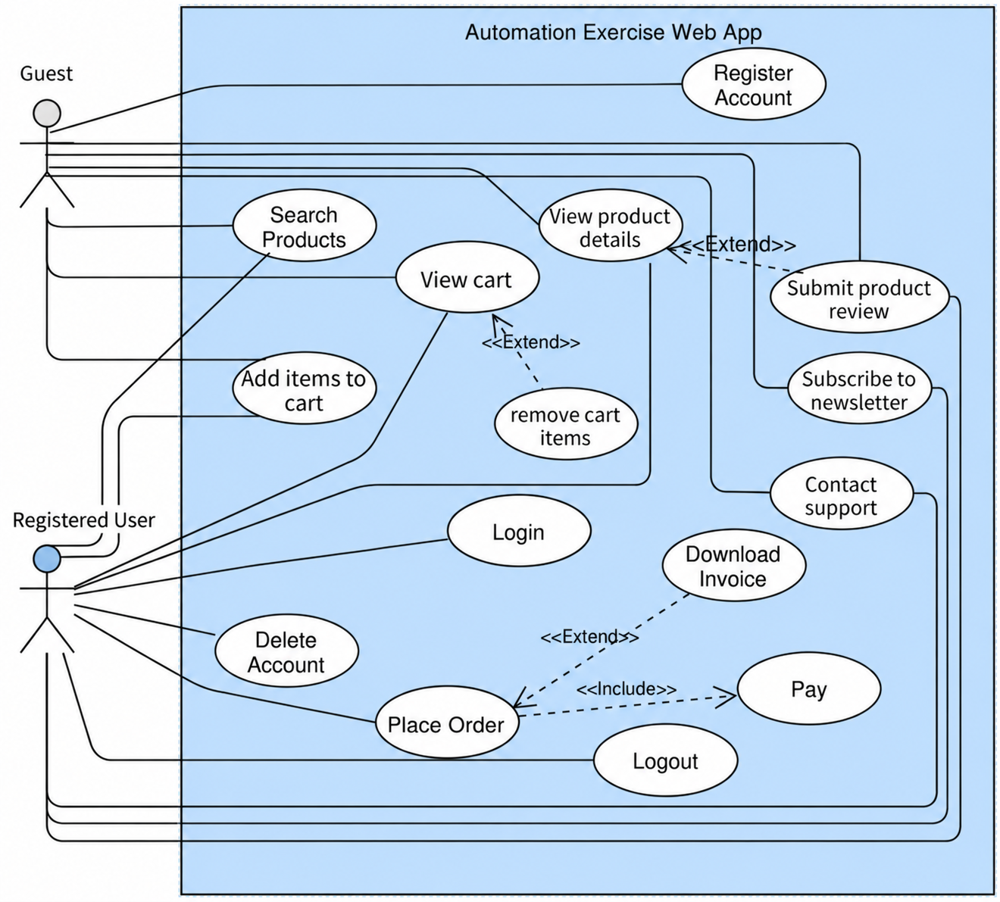

# System Analysis

## 1. Analysis Scope

This is a reverse-analysis document for the public [Automation Exercise](https://automationexercise.com/) website and its documented API. It records the observable business behavior that this project tests; it is not an official product specification from the website owner.

## 2. System Overview

Automation Exercise is a public e-commerce website. Visitors can browse products and search the catalogue. Registered customers can manage an account, add products to a cart, place an order, download an invoice, submit product reviews, contact support, and subscribe to a newsletter.

The system also exposes public REST-like endpoints for product, brand, search, login, and account operations. Requests use `application/x-www-form-urlencoded` parameters and responses are JSON.

### Actors

| Actor               | Description                                                                                           |
|---------------------|-------------------------------------------------------------------------------------------------------|
| Guest visitor       | Browses products, searches, registers, contacts support, subscribes, submits reviews, and manages a cart. |
| Registered customer | Logs in, checks out, downloads an invoice, logs out, and deletes an account.                             |

## 3. Use-Case Diagram

## 4. Features

| ID | Feature | Requirement |
|---|---|---|
| REQ-UI-001 | Login | The system must authenticate a customer who provides valid email and password credentials and display the logged-in user name. |
| REQ-UI-002 | Logout | The system must allow an authenticated customer to end the session and return to the login page. |
| REQ-UI-003 | Registration | The system must create an account when a visitor provides the required registration and address details. |
| REQ-UI-004 | Delete account | The system must allow an authenticated customer to delete their account and display a deletion confirmation. |
| REQ-UI-005 | Product discovery | The system must let a visitor find products through keyword search, category navigation, and brand navigation. |
| REQ-UI-006 | Cart Management | The system must add selected products to the cart, retain requested quantities, and allow selected products to be removed. |
| REQ-UI-007 | Checkout | The system must place an order when an authenticated customer provides order and payment details. |
| REQ-UI-008 | Invoice | After a successful order, the system must allow the customer to download an invoice file. |
| REQ-UI-009 | Contact support | The system must submit a contact request with contact details, a subject, and a message; a supported attachment may be included. |
| REQ-UI-010 | Product review | The system must submit a product review with reviewer details and review text. |
| REQ-UI-011 | Newsletter subscription | The system must confirm newsletter subscription through the footer. |

## 5. API Overview

| Item | Value |
|---|---|
| Base URL | `https://automationexercise.com` |
| API style | Public REST-like HTTP API |
| Request content type | `application/x-www-form-urlencoded` |
| Response format | JSON |
| Response patterns | Collection payloads for products/brands/user details; `responseCode` and `message` for command or validation responses |

> **API response behavior:** The API commonly returns HTTP `200` for both successful and rejected operations. The operation result is provided separately through `responseCode` in the JSON body, so the automated tests validate both values.

## 6. API Documentation

This section documents the eight supported API operations. Each ID identifies one usable method-and-endpoint operation; it is not a UI requirement.

### API-001 — Get All Products

| Field | Value |
|---|---|
| ID | `API-001` |
| Name | Get All Products |
| HTTP method | `GET` |
| Endpoint | `/api/productsList` |
| Request body | None |
| Success response | HTTP `200`; JSON collection of products. |
| Error response | No error response is documented for this supported operation. |

### API-002 — Get All Brands

| Field | Value |
|---|---|
| ID | `API-002` |
| Name | Get All Brands |
| HTTP method | `GET` |
| Endpoint | `/api/brandsList` |
| Request body | None |
| Success response | HTTP `200`; JSON collection of brands. |
| Error response | No error response is documented for this supported operation. |

### API-003 — Search Products

| Field | Value |
|---|---|
| ID | `API-003` |
| Name | Search Products |
| HTTP method | `POST` |
| Endpoint | `/api/searchProduct` |
| Request body | Form parameter: `search_product`. |
| Success response | HTTP `200`; JSON collection of matching products. |
| Error response | HTTP `200`; response body contains `responseCode: 400` and a message that `search_product` is missing. |

### API-004 — Verify Login

| Field | Value |
|---|---|
| ID | `API-004` |
| Name | Verify Login |
| HTTP method | `POST` |
| Endpoint | `/api/verifyLogin` |
| Request body | Form parameters: `email`, `password`. |
| Success response | HTTP `200`; `responseCode: 200`; message: `User exists!`. |
| Error response | HTTP `200`; response body contains `responseCode: 400` when email or password is missing, or `responseCode: 404` with `User not found!` for invalid credentials. |

### API-005 — Create Account

| Field | Value |
|---|---|
| ID | `API-005` |
| Name | Create Account |
| HTTP method | `POST` |
| Endpoint | `/api/createAccount` |
| Request body | `application/x-www-form-urlencoded` |
| `name` | Display name, for example `Sara Ahmed`. |
| `email` | Unique account email, for example `sara@example.com`. |
| `password` | Account password, for example `Test@123`. |
| `title` | Title, for example `Ms`. |
| `birth_date` | Day of birth, for example `15`. |
| `birth_month` | Month of birth, for example `May`. |
| `birth_year` | Year of birth, for example `1995`. |
| `firstname` | First name, for example `Sara`. |
| `lastname` | Last name, for example `Ahmed`. |
| `company` | Company name, for example `Tech Corp`. |
| `address1` | Primary address, for example `123 Main St`. |
| `address2` | Secondary address, for example `Apt 4B`. |
| `country` | Country, for example `India`. |
| `zipcode` | Postal code, for example `12345`. |
| `state` | State or region, for example `Abu Dhabi`. |
| `city` | City, for example `Abu Dhabi`. |
| `mobile_number` | Mobile number, for example `+971501234567`. |
| Success response | HTTP `200`; `responseCode: 201`; message: `User created!`. |
| Error response | HTTP `200`; observed duplicate-email response contains `responseCode: 400`; message: `Email already exists!`. |

### API-006 — Delete Account

| Field | Value |
|---|---|
| ID | `API-006` |
| Name | Delete Account |
| HTTP method | `DELETE` |
| Endpoint | `/api/deleteAccount` |
| Request body | Form parameters: `email`, `password`. |
| Success response | HTTP `200`; `responseCode: 200`; message: `Account deleted!`. |
| Error response | HTTP `200`; observed invalid-credentials response contains `responseCode: 404`; message: `Account not found!`. |

### API-007 — Update Account

| Field | Value |
|---|---|
| ID | `API-007` |
| Name | Update Account |
| HTTP method | `PUT` |
| Endpoint | `/api/updateAccount` |
| Request body | The same form fields as the Create Account Request Body table. |
| Success response | HTTP `200`; `responseCode: 200`; message: `User updated!`. |
| Error response | No error response is documented for this supported operation. |

### API-008 — Get User Details

| Field | Value |
|---|---|
| ID | `API-008` |
| Name | Get User Details |
| HTTP method | `GET` |
| Endpoint | `/api/getUserDetailByEmail` |
| Request body | No body. Query parameter: `email`. |
| Success response | HTTP `200`; JSON user-detail payload. |
| Error response | No error response is documented for this supported operation. |

## 7. Rules

These rules describe conditions that the UI and API must not break.

| Rule ID | Scope | Related feature / API | Rule |
|---|---|---|---|
| RULE-001 | UI | Login | A customer must use valid registered email and password credentials to log in. |
| RULE-002 | UI | Registration | An email address can be used to register one account only. |
| RULE-003 | UI | Delete account | Only an authenticated customer can delete their account. |
| RULE-004 | UI | Cart Management | The cart keeps each selected product and its chosen quantity until the customer removes it or completes an order. |
| RULE-005 | UI | Checkout | Only an authenticated customer may place an order. |
| RULE-006 | UI | Checkout | A successful order requires payment details. |
| RULE-007 | UI | Invoice | An invoice is available only after a successful order. |
| RULE-008 | UI | Contact support | A contact request requires a valid email address. |
| RULE-009 | UI | Product review | A product review requires a valid name, email address, and review text. |
| RULE-010 | UI | Newsletter subscription | A newsletter subscription requires a valid email address. |
| RULE-011 | API | `POST /api/searchProduct` | The `search_product` form parameter is required. |
| RULE-012 | API | `POST /api/verifyLogin` | Both `email` and `password` form parameters are required. |
| RULE-013 | API | `POST /api/verifyLogin` | Login credentials must belong to an existing account. |
| RULE-014 | API | `POST /api/createAccount` | Account creation uses the documented account profile form fields and a unique email. |
| RULE-015 | API | `DELETE /api/deleteAccount` | Account deletion requires the account's `email` and `password`. |
| RULE-016 | API | Unsupported methods | The documented unsupported methods must be rejected: `POST /api/productsList`, `PUT /api/brandsList`, and `DELETE /api/verifyLogin`. |
